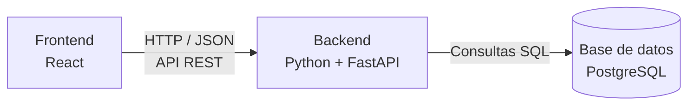
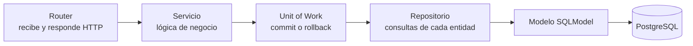

# Arquitectura del Proyecto — Sistema de Gestión para Gimnasios

## Arquitectura elegida

El sistema sigue una arquitectura **cliente-servidor de tres capas**, con separación clara entre presentación, lógica de negocio y persistencia:

- **Capa de presentación (Frontend):** React. Consume la API del backend mediante peticiones HTTP y renderiza el Panel Administrador y el Panel del Alumno.
- **Capa de lógica de negocio (Backend):** Python + FastAPI, expuesto como una API REST. Por dentro, cada petición recorre cuatro capas (router, servicio, Unit of Work y repositorio), apoyadas en los modelos de las tablas y acompañadas por los esquemas y las dependencias:
  - **Routers** — definen los endpoints disponibles.
  - **Esquemas** — definen y validan los datos de entrada y de salida de cada endpoint.
  - **Dependencias y middleware** — autenticación de sesiones, control de permisos según el perfil del usuario, límite de intentos fallidos y registro de acciones sensibles.
  - **Servicios** — contienen la lógica de negocio y no escriben SQL ni confirman transacciones.
  - **Unit of Work** — controla la transacción de cada caso de uso: todo se confirma o nada persiste.
  - **Repositorios** — encapsulan el acceso a los datos de cada entidad y no confirman la transacción.
  - **Modelos** — modelos SQLModel que reflejan las tablas, sobre los que trabajan los repositorios para comunicarse con PostgreSQL.
- **Capa de persistencia (Base de datos):** PostgreSQL, con el esquema relacional definido en [`/database/schema.sql`](../database/schema.sql).

## Decisiones

- **Separación de responsabilidades:** cada capa puede modificarse o reemplazarse sin afectar directamente a las demás (por ejemplo, cambiar el frontend sin tocar el backend).
- **Mantenibilidad:** organizar el backend en capas (routers/esquemas/servicios/repositorios) facilita ubicar y corregir código a medida que el sistema crezca.
- **Organización por funcionalidad:** el backend tiene una carpeta por módulo (alumnos, planes, pagos, etc.), cada una con sus modelos, esquemas, repositorio, Unit of Work, servicio y rutas, en lugar de agrupar por tipo de archivo.
- **Atomicidad de los casos de uso:** el pago, el check-in y la renovación escriben en varias tablas; el Unit of Work garantiza que todas esas escrituras se confirmen juntas o que ninguna persista.
- **Despliegue independiente:** cada capa se aloja en un servicio distinto en la nube, lo que permite escalar o actualizar una sin afectar a las otras.

## Flujo de una petición en el backend

Cada petición recorre las capas en un único sentido:

Reglas que se respetan en todos los módulos:

- El **router** solo traduce HTTP: recibe los datos, llama al servicio y devuelve la respuesta. No contiene lógica de negocio.
- El **servicio** contiene las reglas de negocio y lanza errores de negocio; no escribe consultas SQL ni confirma transacciones.
- El **repositorio** encapsula las consultas de una entidad. Hereda de un repositorio base genérico y nunca confirma la transacción.
- Solo el **Unit of Work** confirma (`commit`) o descarta (`rollback`) la transacción: si algo falla a mitad de un caso de uso, no queda nada guardado a medias.
- Los errores de negocio se traducen a códigos HTTP en un solo lugar (401, 403, 404, 409 y 422).

## Tecnologías 

| Capa | Tecnología |
|---|---|
| Frontend | React |
| Backend | Python + FastAPI (API REST) |
| Base de datos | PostgreSQL |
| Control de versiones | Git + GitHub |

## Comunicación entre capas

El frontend se comunica con el backend exclusivamente a través de una API REST. El backend es el único componente con acceso directo a la base de datos — el frontend nunca consulta PostgreSQL de forma directa, lo que mantiene la lógica de negocio y las validaciones centralizadas del lado del servidor.

## Seguridad

El detalle completo está en [`seguridad_y_permisos.md`](./seguridad_y_permisos.md). En resumen:

- **Acceso del alumno:** requiere DNI y código de acceso. El código lo genera el sistema, se guarda como hash y, tras 5 intentos fallidos seguidos, el acceso se bloquea 15 minutos. El Panel del Alumno es de solo lectura y no muestra la ficha de salud.
- **Acceso del personal:** requiere usuario y contraseña (guardada como hash). La sesión se guarda en una cookie HttpOnly, que el código de la página no puede leer, con una duración configurable (8 horas por defecto). Cada usuario tiene un perfil (administrador o entrenador) y el backend valida los permisos y que la cuenta siga activa en cada petición.
- **Datos personales y de salud:** el acceso se limita por perfil, la comunicación usa HTTPS y se toman como marco los principios de la Ley 25.326. No se almacenan datos de tarjetas.
- **Integridad:** las reglas críticas se controlan también en la base de datos (ver [`integridad_datos.md`](./integridad_datos.md)).

## Despliegue

El despliegue de la aplicación —previsto en Vercel (frontend), Render o Railway (backend) y Railway o Supabase (base de datos PostgreSQL)— se definirá de manera definitiva en etapas posteriores, dando cumplimiento al Requerimiento No Funcional RNF04 (Disponibilidad), el cual exige garantizar la accesibilidad continua del sistema mediante servicios de hosting en la nube, sin condicionar la arquitectura a un proveedor tecnológico específico en esta fase.

## Métricas operativas (propuestas)

- Cantidad de alumnos activos / por vencer / vencidos (en tiempo real, vía Dashboard).
- Tiempo de respuesta promedio de los endpoints principales (objetivo: < 2s).
- Tasa de errores de la API.
- Cantidad de sugerencias de IA generadas vs. aprobadas por semana.

## Lineamientos de despliegue

- Variables de entorno (credenciales de base de datos, clave de firma de las sesiones, puertos) gestionadas fuera del código fuente, mediante archivos .env no versionados.
- El backend se despliega como servicio independiente del frontend, permitiendo actualizar uno sin reconstruir el otro.
- La base de datos mantiene backups automáticos provistos por el servicio de hosting elegido.
- Toda la comunicación usa HTTPS, y el backend acepta solo el origen del frontend (CORS, con credenciales para la cookie de sesión).
- Ver el diagrama de despliegue en [`diagrama_despliegue.md`](./diagrama_despliegue.md).

## Auditoría, contingencia y recuperación

El sistema registra las acciones sensibles en el log del backend y conserva el historial de operaciones sin borrado físico. Para continuar operando ante una caída se usa una planilla manual de contingencia, y para recuperar datos se usan copias de respaldo periódicas junto con `database/schema.sql`. El detalle está en [`contingencia_auditoria_recuperacion.md`](./contingencia_auditoria_recuperacion.md).