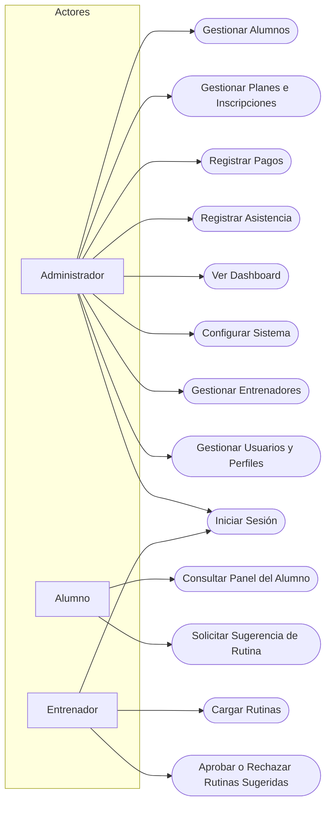

# Casos de Uso — Sistema de Gestión para Gimnasios

## Actores

- **Administrador** — dueño o responsable del gimnasio, que también atiende el mostrador; opera el Panel Administrador con todas las funciones de gestión.
- **Alumno** — consulta el Panel del Alumno.
- **Entrenador** — carga rutinas y aprueba sugerencias del Asistente de IA.

Todos los casos de uso del personal requieren haber iniciado sesión (UC13) y respetan la matriz de permisos de [`seguridad_y_permisos.md`](./seguridad_y_permisos.md).

## Diagrama de Casos de Uso

## Listado de Casos de Uso

| ID | Nombre | Actor | RF relacionado |
|---|---|---|---|
| UC01 | Gestionar Alumnos | Administrador | RF01, RF02, RF09, RF15, RF19 |
| UC02 | Gestionar Planes e Inscripciones | Administrador | RF03, RF04, RF05 |
| UC03 | Registrar Pagos | Administrador | RF06, RF14 |
| UC04 | Registrar Asistencia | Administrador | RF07, RF20 |
| UC05 | Ver Dashboard | Administrador | RF08 |
| UC06 | Configurar Sistema | Administrador | RF16 |
| UC07 | Gestionar Entrenadores | Administrador | RF17 |
| UC08 | Consultar Panel del Alumno | Alumno | RF10, RF19 |
| UC09 | Solicitar Sugerencia de Rutina | Alumno | RF12 |
| UC10 | Cargar Rutinas | Entrenador | RF11, RF18 |
| UC11 | Aprobar o Rechazar Rutinas Sugeridas | Entrenador | RF13, RF18 |
| UC12 | Gestionar Usuarios y Perfiles | Administrador | RF23 |
| UC13 | Iniciar Sesión | Administrador, Entrenador | RF21, RF22 |

## Especificación detallada de los casos de uso principales

### UC03 — Registrar Pagos
- **Actor:** Administrador
- **Precondición:** El alumno tiene una inscripción existente.
- **Flujo principal:**
  1. El administrador busca al alumno.
  2. Ingresa monto, fecha y método de pago.
  3. El sistema calcula la nueva fecha de vencimiento (RN02, RN03, RN04) y, si el plan es por clases, actualiza el saldo (RN32).
  4. El sistema confirma el registro.
- **Flujo alternativo:** Si el alumno no tiene inscripción activa, el sistema solicita primero inscribirlo (UC02).

### UC04 — Registrar Asistencia
- **Actor:** Administrador
- **Precondición:** El alumno está registrado y tiene una inscripción vigente.
- **Flujo principal:**
  1. El usuario busca al alumno y registra el ingreso.
  2. El sistema verifica que no haya un ingreso dentro de las 2 horas anteriores (RN12).
  3. Si la inscripción es por clases, el sistema descuenta una clase del saldo junto con el registro de la asistencia (RN30).
  4. El sistema confirma el ingreso.
- **Flujo alternativo 1:** Si hay un ingreso dentro de la ventana de 2 horas, el sistema rechaza el registro por duplicado.
- **Flujo alternativo 2:** Si el saldo de clases es cero o la inscripción está vencida, el sistema no registra el ingreso y avisa que corresponde renovar (RN32).

### UC08 — Consultar Panel del Alumno
- **Actor:** Alumno
- **Precondición:** El alumno tiene un código de acceso vigente.
- **Flujo principal:**
  1. El alumno ingresa su DNI y su código de acceso (RN16).
  2. El sistema valida ambos datos.
  3. El sistema muestra su estado de cuota, clases restantes si corresponde, historial de asistencia, checklist y rutinas aprobadas (RN17).
- **Flujo alternativo:** Si algún dato es incorrecto, el sistema rechaza con un mensaje genérico; tras 5 intentos fallidos seguidos bloquea el acceso 15 minutos (RN38).

### UC09 — Solicitar Sugerencia de Rutina
- **Actor:** Alumno
- **Precondición:** El alumno tiene ficha de salud cargada.
- **Flujo principal:**
  1. El alumno solicita una sugerencia desde el Panel del Alumno.
  2. El sistema filtra el banco de rutinas según su ficha de salud (RN18, RN20).
  3. El sistema crea la sugerencia en estado `pendiente`.
  4. El alumno recibe el mensaje de que la sugerencia está sujeta a aprobación del entrenador (RN23).
- **Flujo alternativo:** Si no hay rutinas compatibles, el sistema informa que no hay sugerencias disponibles.

### UC11 — Aprobar o Rechazar Rutinas Sugeridas
- **Actor:** Entrenador
- **Precondición:** Existe al menos una rutina en estado `pendiente` y el entrenador tiene un usuario vinculado (RN24, RN35).
- **Flujo principal:**
  1. El entrenador revisa las sugerencias pendientes.
  2. Aprueba o rechaza cada una.
  3. El sistema actualiza el estado y registra el entrenador y la fecha de validación.
- **Flujo alternativo:** Si rechaza, la rutina no queda visible para el alumno (RN21).

### UC13 — Iniciar Sesión
- **Actor:** Administrador o Entrenador
- **Precondición:** El usuario está registrado y activo.
- **Flujo principal:**
  1. El usuario ingresa su usuario y contraseña (RN33).
  2. El sistema valida las credenciales y abre una sesión temporal.
  3. El sistema habilita solo las funciones del perfil del usuario (RN34).
- **Flujo alternativo:** Si las credenciales son incorrectas, el sistema rechaza con un mensaje genérico; tras 5 intentos fallidos seguidos bloquea el acceso 15 minutos (RN38).