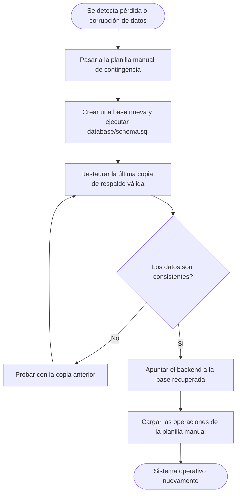

# Auditoría, Contingencia y Recuperación — Sistema de Gestión para Gimnasios

Este documento describe, a nivel conceptual, cómo se registran las acciones importantes, cómo se sigue operando si el sistema falla y cómo se recuperan los datos. Complementa [`arquitectura.md`](./arquitectura.md) y [`seguridad_y_permisos.md`](./seguridad_y_permisos.md).

## 1. Auditoría

### Qué se registra y dónde

| Fuente | Qué permite saber | Regla |
|---|---|---|
| Tablas de negocio (`pagos`, `inscripciones`, `asistencias`, `rutinas`, `rutinas_asignadas`) | Qué ocurrió y cuándo; en rutinas, qué entrenador actuó. No se borran físicamente (`ON DELETE RESTRICT`) | RN28 |
| Log del backend | Quién ejecutó una acción sensible, cuál fue y cuándo | RN40 |

### Formato del registro de acciones sensibles

Cada acción sensible genera una línea de log con: fecha y hora, usuario (o "alumno" en el Panel del Alumno), acción, entidad afectada y resultado (éxito o rechazo).

Ejemplo: `2026-11-03 10:42:15 | usuario=admin | BAJA_ALUMNO | alumnos#12 | OK`

### Qué no se registra

Contraseñas, códigos de acceso ni datos de salud, para no exponer información sensible en los logs.

### Quién consulta y por cuánto tiempo

- El administrador consulta el log desde el servicio de hosting del backend.
- Se conserva mientras el proveedor lo permita; si hace falta guardarlo más tiempo, se exporta periódicamente.

## 2. Contingencia (continuidad operativa)

| Escenario | Impacto | Respuesta |
|---|---|---|
| Sin internet o sistema caído en horario de atención | No se pueden registrar ingresos ni pagos | Se usa la planilla manual de contingencia (ver abajo); los datos se cargan al volver el servicio (RN41) |
| Falla del servicio de hosting del backend | El sistema no responde | Se espera la restauración del proveedor; mientras tanto, planilla manual. El código se puede redesplegar desde GitHub |
| Pérdida o corrupción de datos | Se pierde información de alumnos, pagos o asistencias | Procedimiento de recuperación (sección 3) |
| Carga errónea de un dato | Un pago o ingreso mal cargado | El registro no se elimina (RN28): el administrador corrige el dato y la modificación queda registrada en el log (RN40) |
| Contraseña de personal olvidada | Un usuario no puede entrar | El administrador restablece la contraseña (RF23) |
| Código de acceso de alumno perdido | El alumno no puede ver su panel | El personal regenera el código (RF15) |

**Planilla manual de contingencia:** hoja impresa con los campos fecha, hora, alumno (DNI), tipo de operación (ingreso o pago), monto y método de pago, y quién la anotó. Al restablecerse el sistema, se carga conservando la fecha y hora reales de cada operación (RN41).

## 3. Recuperación

### Copias de respaldo

- Se hacen copias de respaldo periódicas de la base de datos (RN42): automáticas, si el plan del proveedor de hosting las incluye; si no, exportaciones manuales con `pg_dump` al menos una vez por día hábil.
- Las copias se guardan fuera del servicio donde está la base (por ejemplo, un almacenamiento en la nube distinto) y con acceso restringido.
- Antes de la entrega final se realiza una prueba de restauración en una base de prueba, para verificar que la copia sirve.

### Objetivos propuestos

| Indicador | Objetivo |
|---|---|
| Pérdida máxima de datos aceptable | 24 horas (una copia por día) |
| Tiempo de recuperación | Dentro de una jornada laboral |

### Procedimiento de recuperación

El archivo `schema.sql` permite reconstruir la estructura completa de la base ante una pérdida total, y las copias de respaldo recuperan los datos.

## 4. Responsabilidades

| Tarea | Responsable |
|---|---|
| Realizar y guardar las copias de respaldo | Administrador |
| Consultar el registro de acciones sensibles | Administrador |
| Mantener la planilla de contingencia disponible en el mostrador | Administrador |
| Redesplegar el sistema ante una falla del servicio | Equipo de desarrollo |
