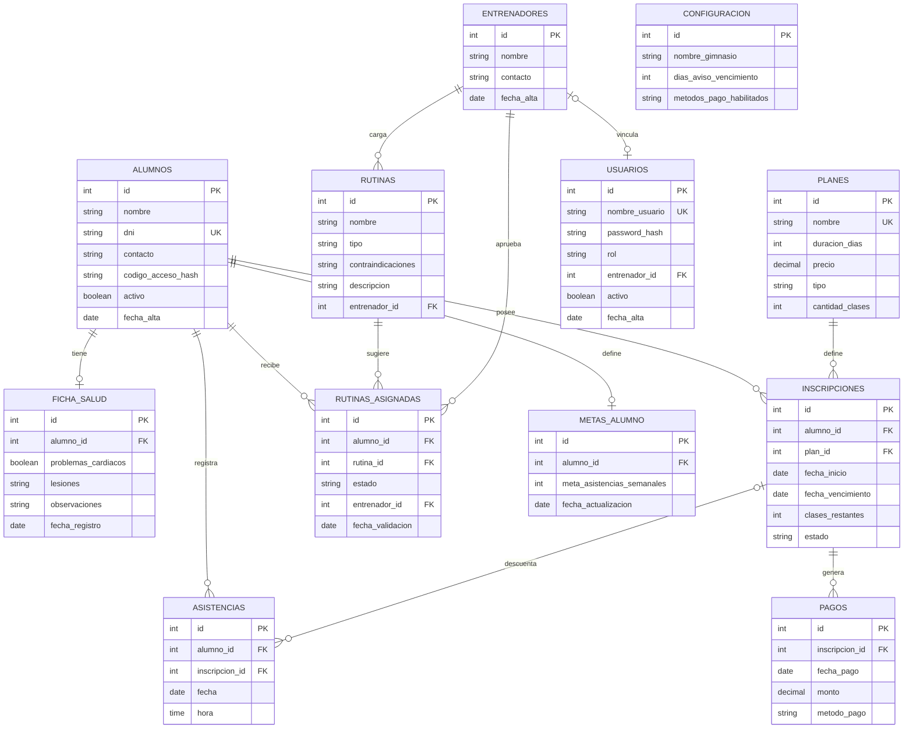

# Diagrama Entidad-Relación — Sistema de Gestión para Gimnasios

Diagrama construido con sintaxis Mermaid.

## Entidades y relaciones

- **alumnos** — entidad central del sistema. Un alumno tiene una ficha_salud, puede tener varias inscripciones a lo largo del tiempo, varios registros de asistencias, y varias rutinas_asignadas. Guarda el código de acceso solo como hash.
- **ficha_salud** — como máximo una por alumno (relación 1 a 0..1). Guarda los datos de salud declarados, usados para filtrar rutinas seguras.
- **planes** — catálogo de planes disponibles (mensual, trimestral, por clases, etc.), independiente de los alumnos. Los planes por clases indican `cantidad_clases`.
- **inscripciones** — relaciona un alumno con un plan en un período determinado, con su fecha de vencimiento y estado. En los planes por clases lleva el saldo `clases_restantes`..
- **pagos** — cada pago pertenece a una inscripción; un alumno puede tener muchos pagos a lo largo del tiempo (historial completo, ver RF14).
- **asistencias** — un registro por cada check-in de un alumno. Se asocia a la inscripción contra la que se registró el ingreso, lo que permite reconstruir el consumo de clases.
- **rutinas** — banco de rutinas predefinidas, cargadas por el entrenador, con sus contraindicaciones.
- **rutinas_asignadas** — relaciona una rutina con un alumno, con su estado de aprobación (pendiente / aprobada / rechazada).
- **entrenadores** — personal responsable de cargar las rutinas al banco y de aprobar o rechazar las sugerencias emitidas por el Asistente de IA.
- **usuarios** — cuentas del personal que accede al Panel Administrador, con su perfil (administrador o entrenador). Un usuario con perfil entrenador se vincula con un registro de entrenadores.
- **metas_alumno** — como máximo una por alumno (relación 1 a 0..1). Almacena el objetivo de asistencias semanales configurado para cada alumno, utilizado para calcular su checklist personal en el Panel del Alumno.
- **configuracion** — tabla de parámetros generales del sistema, sin relación directa con las demás entidades. Admite una sola fila.

## Cardinalidades principales

| Relación | Cardinalidad |
|---|---|
| alumnos → ficha_salud | 1 a 0..1 |
| alumnos → metas_alumno |1 a 0..1 |
| alumnos → inscripciones | 1 a muchos |
| planes → inscripciones | 1 a muchos |
| inscripciones → pagos | 1 a muchos |
| alumnos → asistencias | 0..1 a muchos |
| alumnos → rutinas_asignadas | 1 a muchos |
| rutinas → rutinas_asignadas | 1 a muchos |
| entrenadores → rutinas | 1 a muchos |
| entrenadores → rutinas_asignadas | 1 a muchos |
| entrenadores → usuarios | 0..1 a 0..1 |

## Restricciones de Unicidad (UNIQUE)

- **`alumnos.dni` (UNIQUE):** Impide el registro duplicado de un mismo documento de identidad.
- **`usuarios.nombre_usuario`:** impide dos usuarios con el mismo nombre.
- **`usuarios.entrenador_id` (UNIQUE + FK):** un entrenador se vincula con, como máximo, un usuario.
- **`ficha_salud.alumno_id` y `metas_alumno.alumno_id` (UNIQUE + FK):** aseguran a nivel físico en la base de datos que cada alumno tenga, como máximo, una ficha de salud y una meta.
- **`planes.nombre` (UNIQUE):** Evita la duplicación de nombres en el catálogo de planes.

## Otras restricciones

El resto de las restricciones (CHECK, claves foráneas con `ON DELETE RESTRICT`, fila única de configuración) y las reglas que controla la aplicación están en [`integridad_datos.md`](./integridad_datos.md).