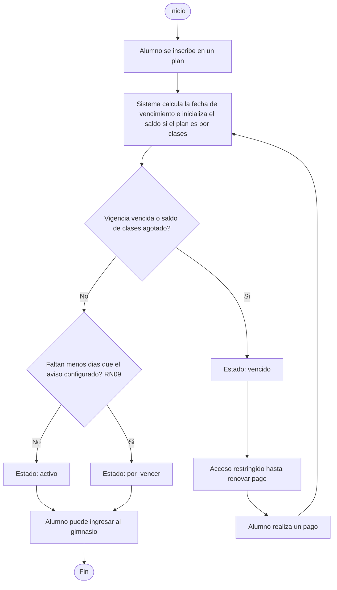
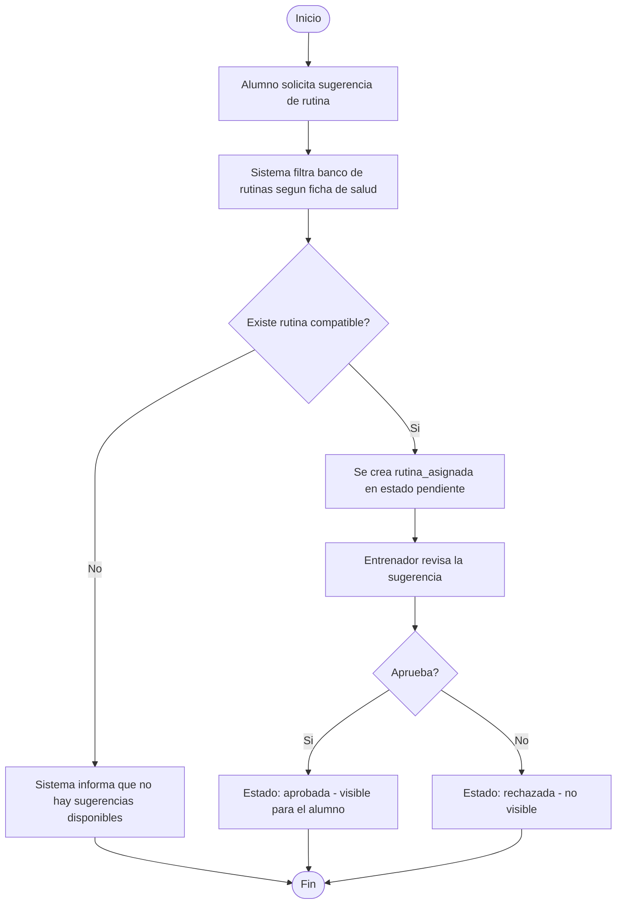
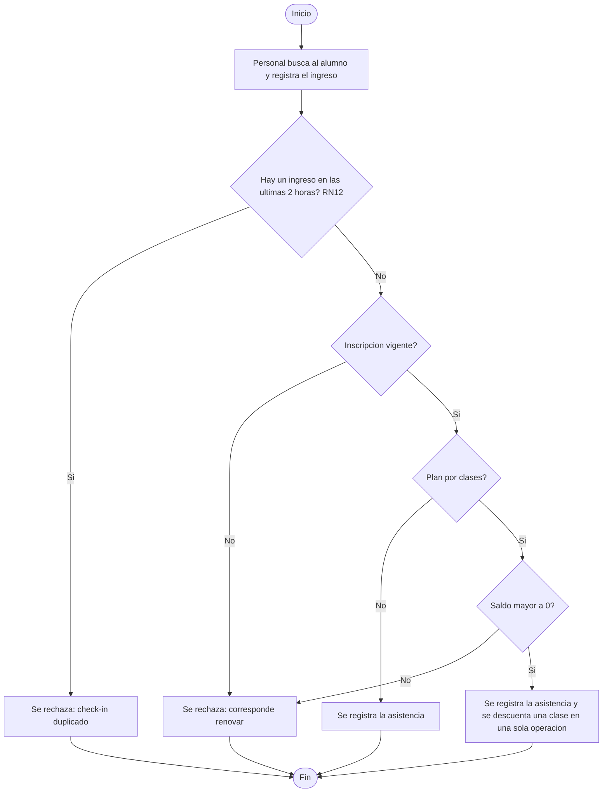

# Diagramas de Actividades — Sistema de Gestión para Gimnasios

## 1. Control de vencimiento de inscripción

## 2. Aprobación de rutina sugerida por el Asistente de IA

## 3. Registro de ingreso con plan por clases

