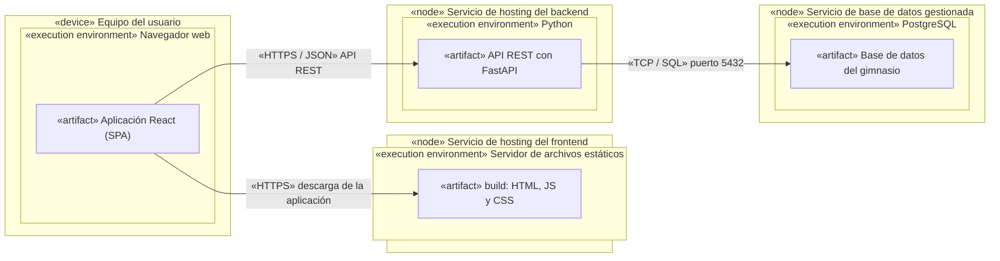

# Diagrama de Despliegue — Sistema de Gestión para Gimnasios

Diagrama de despliegue siguiendo la notación UML: los nodos se identifican con estereotipos (`«device»`, `«node»`, `«execution environment»`), los componentes desplegados con `«artifact»` y los caminos de comunicación con el protocolo entre guillemets. Mermaid no dibuja los nodos como cubos 3D, por lo que cada nodo se representa como un contenedor con su estereotipo y el anidamiento indica qué se ejecuta dentro de qué.

## Elementos del diagrama

| Nodo | Estereotipo | Entorno de ejecución | Artefacto desplegado | Plataforma prevista |
|---|---|---|---|---|
| Equipo del usuario | `«device»` | Navegador web | Aplicación React (SPA) descargada del hosting del frontend | Cualquier navegador moderno |
| Hosting del frontend | `«node»` | Servidor de archivos estáticos | Build de React (HTML, JS y CSS) | Vercel |
| Hosting del backend | `«node»` | Python | API REST con FastAPI | Render o Railway |
| Base de datos gestionada | `«node»` | PostgreSQL | Base de datos creada con `database/schema.sql` | Railway o Supabase |

## Caminos de comunicación

| Origen | Destino | Protocolo | Detalle |
|---|---|---|---|
| Navegador | Hosting del frontend | HTTPS | Descarga de la aplicación (RNF09) |
| Navegador | Hosting del backend | HTTPS con datos en JSON | La aplicación React ejecutada en el navegador consume la API REST. El backend acepta solo el origen del frontend (CORS) |
| Backend | Base de datos | TCP (SQL), puerto 5432 | Solo el backend accede a la base; el navegador nunca se conecta a ella |

## Configuración por entorno

- Las credenciales de la base de datos y la clave de firma de las sesiones se definen como variables de entorno en el hosting del backend, fuera del código y de GitHub.
- La base de datos solo acepta conexiones del backend.
- La plataforma definitiva de cada nodo se confirma en la etapa de despliegue (ver [`arquitectura.md`](./arquitectura.md)).