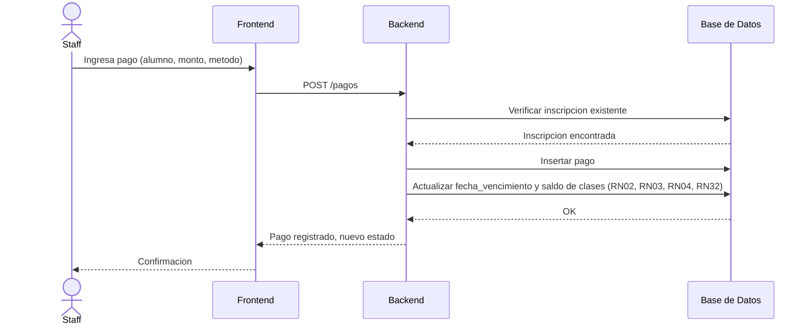
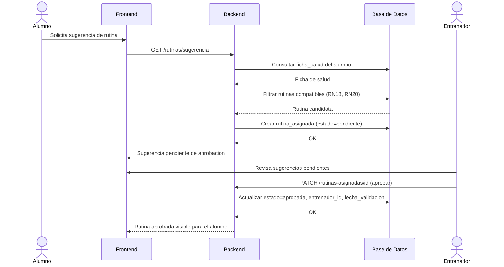
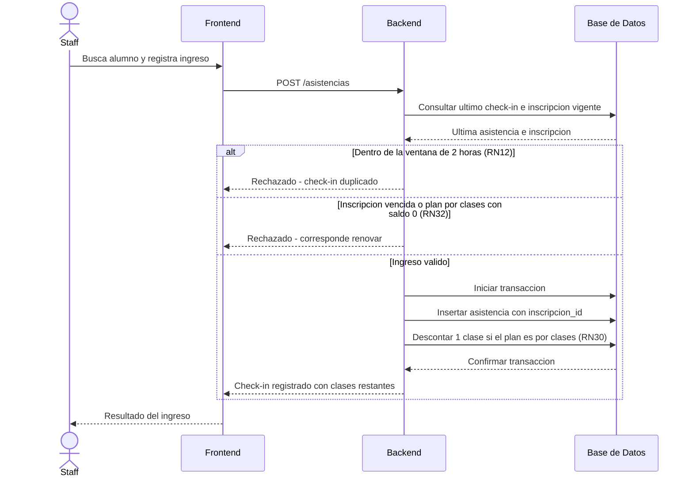
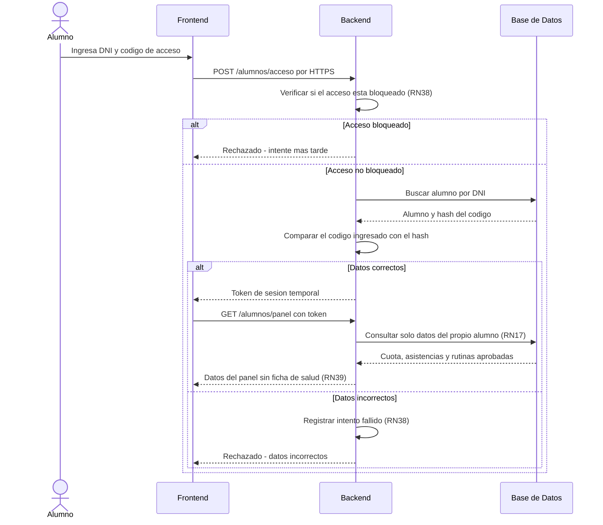
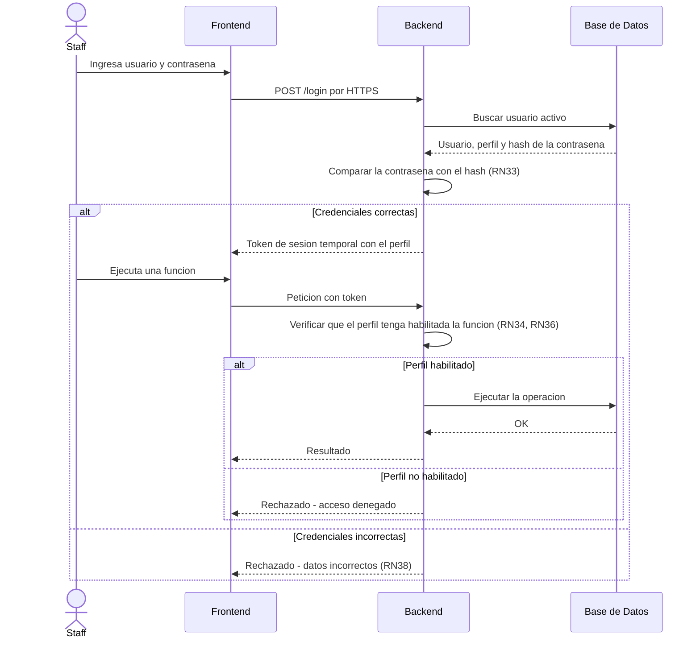

# Diagramas de Secuencia — Sistema de Gestión para Gimnasios

## 1. Registrar pago y renovar inscripción (RF06)

## 2. Alumno solicita sugerencia de rutina y entrenador la aprueba (RF12, RF13)

## 3. Check-in de asistencia con descuento de clases (RF07, RF20, RN12, RN30, RN32)

## 4. Acceso del alumno con DNI y código (RF10, RN16, RN17, RN38)

## 5. Inicio de sesión del personal y control por perfil (RF21, RF22, RN33, RN34)

