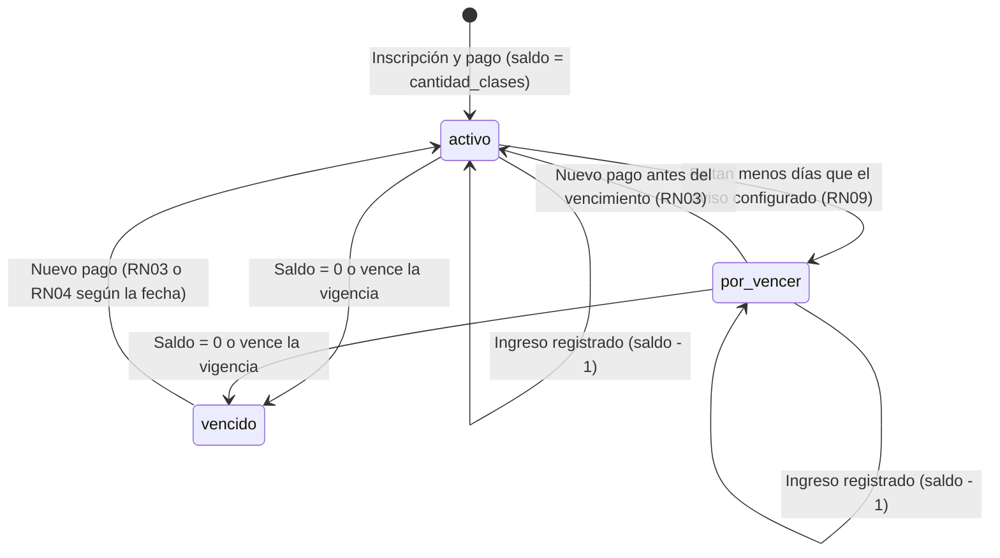

# Gestión de Planes por Cantidad de Clases — Sistema de Gestión para Gimnasios

Este documento completa la definición de los planes de tipo `clases` (RF03, RF20), indicando cómo se gestionan, cómo se descuentan las clases usadas, qué ocurre cuando se agotan y cómo se controla su vigencia.

## Tipos de plan

| Aspecto | Plan por tiempo (`tiempo`) | Plan por clases (`clases`) |
|---|---|---|
| Ejemplo | Mensual libre | Pack de 10 clases |
| Datos del plan | `duracion_dias`, `precio` | `duracion_dias` (vigencia), `precio`, `cantidad_clases` |
| Saldo en la inscripción | No aplica (`clases_restantes` es NULL) | `clases_restantes` (se inicializa con `cantidad_clases`) |
| Qué consume el ingreso | Nada: el alumno entra mientras esté vigente | Una (1) clase por cada ingreso registrado |
| Cuándo pasa a `vencido` | Al vencer la fecha | Al vencer la fecha **o** al llegar el saldo a cero, lo que ocurra primero |

## Datos involucrados

| Tabla | Columna | Función |
|---|---|---|
| `planes` | `cantidad_clases` | Clases que incluye el plan (solo para tipo `clases`) |
| `planes` | `duracion_dias` | Vigencia máxima del plan, también para los de clases |
| `inscripciones` | `clases_restantes` | Saldo actual de clases del alumno |
| `inscripciones` | `fecha_vencimiento` | Fin de la vigencia (RN02) |
| `asistencias` | `inscripcion_id` | Inscripción contra la que se registró el ingreso, para poder reconstruir el consumo |

## Reglas aplicadas

- **RN29:** un plan por clases define `cantidad_clases` y vigencia; uno por tiempo no define cantidad de clases.
- **RN30:** al inscribir, el saldo arranca en `cantidad_clases`; cada ingreso descuenta una clase, en la misma operación que registra la asistencia.
- **RN31:** la inscripción pasa a `vencido` cuando el saldo llega a cero o vence la vigencia. Las clases no usadas al vencer la vigencia se pierden.
- **RN32:** con saldo cero no se registra el ingreso y se avisa al personal que corresponde renovar. Al renovar con un nuevo pago se aplica RN03 (si la vigencia todavía no venció) o RN04 (si ya venció), tomando como criterio la **fecha de vencimiento** y no el estado.

## Ciclo de vida de una inscripción por clases

## Ejemplos

Plan "Pack 10 clases": `cantidad_clases = 10`, `duracion_dias = 60`. Alta el 01/11/2026, vigencia hasta el 31/12/2026, saldo inicial 10.

| Caso | Situación | Qué hace el sistema | Resultado |
|---|---|---|---|
| A | El alumno usa las 10 clases el 20/11. Intenta ingresar de nuevo. | Rechaza el ingreso y avisa al personal (RN32). El estado pasa a `vencido` por saldo (RN31). | No ingresa hasta renovar |
| A (renovación) | Paga el 22/11. La vigencia anterior (31/12) todavía no venció. | Aplica RN03: vencimiento = 31/12 + 60 días. Saldo = 0 + 10. | Vence el 01/03/2027, saldo 10 |
| B | Paga el 15/12 con saldo 6 y vigencia vigente (faltan 16 días). | Aplica RN03: suma la vigencia y las clases. | Vence el 01/03/2027, saldo 16 |
| C | Llega el 31/12 con saldo 3 sin renovar. | Pasa a `vencido` por fecha. Las 3 clases se pierden (RN31). | Sin ingreso hasta renovar |
| C (renovación) | Paga el 10/01/2027, con la vigencia ya vencida. | Aplica RN04: vencimiento = fecha de pago + 60 días. El saldo se reinicia. | Vence el 11/03/2027, saldo 10 |

## Qué ve cada perfil

- **Administrador:** al buscar al alumno ve las clases restantes y la fecha de vencimiento; recibe el aviso de saldo agotado al intentar registrar el ingreso.
- **Alumno (Panel del Alumno):** ve sus clases restantes y la fecha hasta la que puede usarlas.
- **Dashboard:** el indicador de cuotas vencidas incluye las inscripciones por clases agotadas.